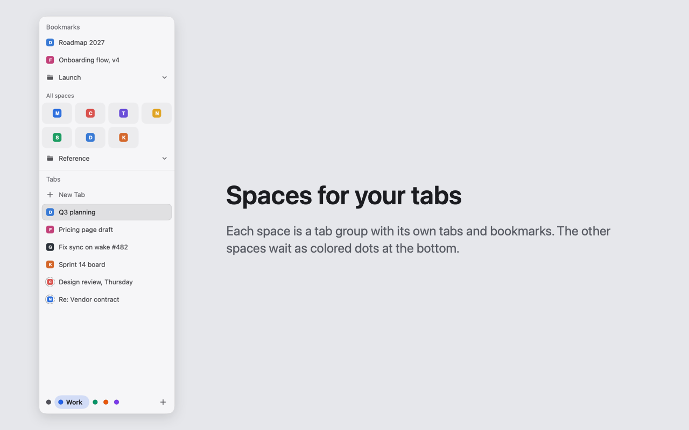

# ArcSide

Arc-style spaces for the [Aside](https://aside.com) browser on the Mac.

A space is a tab group with its own tabs and bookmarks. The sidebar shows the active space and slides out when the pointer reaches the left edge of an Aside window, or when you press Ctrl+Shift+Space. The other spaces are the colored dots at the bottom: click one, swipe with two fingers, or press Ctrl+Shift+Left or Right. Pages on your bookmarks bar show as tiles in every space. Nothing is closed or hidden, and Aside keeps putting idle tabs to sleep.

## Install

ArcSide needs macOS 15 or later and Aside. It has two parts, and you need both.

1. Download `ArcSide-<version>.dmg` from the [latest release](https://github.com/om-ray/ArcSide/releases/latest), open it, and drag ArcSide to Applications.
2. Open ArcSide from Applications. A setup window lists what is left to do.
3. Install the [ArcSide extension](https://chromewebstore.google.com/detail/koegjgddajbphljjgaapdgbkbkchpkhp) in Aside.

Aside starts the app whenever the extension connects and stops it when Aside quits, so there is nothing to launch by hand after setup. The setup window opens again from Settings > General > Set Up….

## Updates

The extension updates from the Chrome Web Store. The app checks this page's releases once a day and asks before it installs one. Settings > About has Check for Updates…. If the two parts get out of step, the sidebar says which one to update.

## Uninstall

In ArcSide's Settings > About, click Uninstall ArcSide…. It removes the files that let Aside start the app and the app's settings, then moves the app to the Trash. Then remove the extension in Aside's `chrome://extensions`.

## Privacy

Everything stays on your Mac. The extension talks only to the ArcSide app, and the app's only network request is its update check against this page. Read the [privacy policy](privacy.md).

## Help

Open an [issue](https://github.com/om-ray/ArcSide/issues) or email om@ray.vin.
